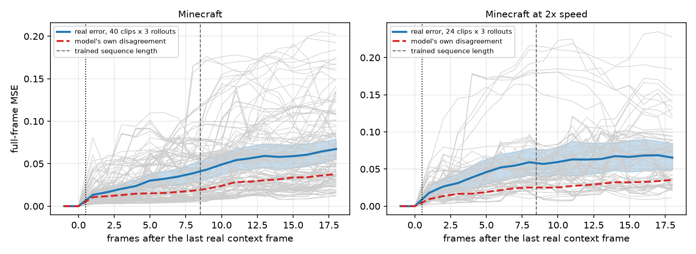
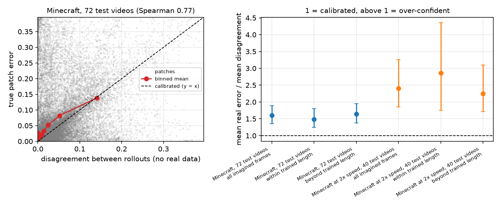
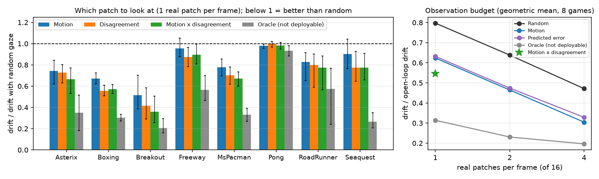
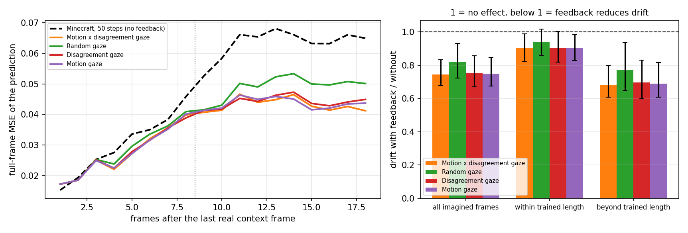
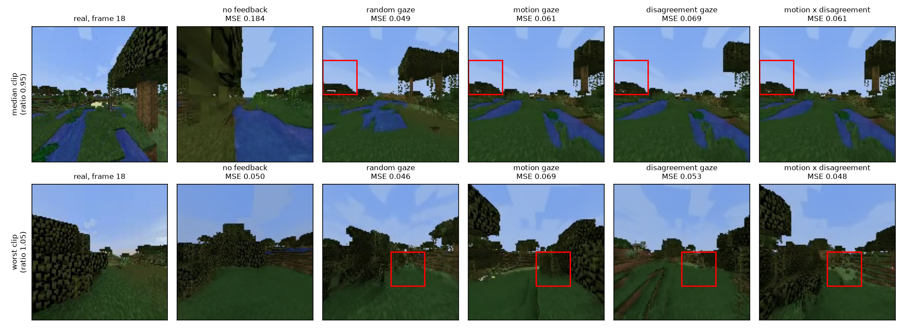
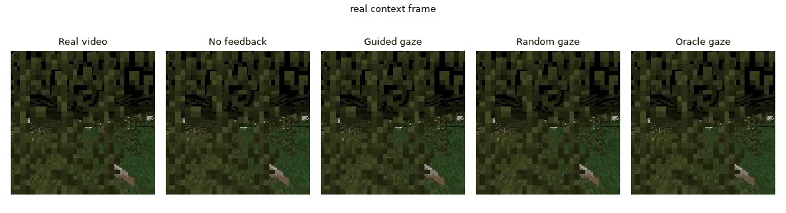

# wm-selfaudit

**Can a world model tell how far its imagination has drifted from reality?**

Paper (preprint): [Unbiased Estimation and Active Correction of Rollout Drift in Diffusion World Models Using Sparse Real Observations](https://doi.org/10.5281/zenodo.23500416)

A video world model imagines the future, but it has no idea how wrong that imagined future is. The obvious fix is to ask the model itself: roll it out a few times and treat the disagreement between rollouts as its error estimate. I tried this on two pretrained diffusion world models and in both cases the answer is no, the model is over-confident.

- On [Diffusion Forcing](https://github.com/buoyancy99/diffusion-forcing) (NeurIPS 2024) in Minecraft, **the real error is 1.6 times the model's own disagreement on 72 held-out test videos** (1.85 on the 10 validation videos). I used the official Minecraft checkpoint (the repository's temporal-attention reimplementation). When the game is played at twice the training speed the gap gets bigger, about 2.2 to 2.4 times. The same thing shows up with the perceptual distance LPIPS, not just pixel error.
- On [DIAMOND](https://github.com/eloialonso/diamond) (NeurIPS 2024), on 8 Atari games and 256 real episodes, it is much worse: real error is 1.8× to 144× the disagreement.

So I looked at how to measure the drift properly with very little real data. The agent looks at **one real 32×32 patch per frame (1/16 of the pixels)** and combines it with an error predictor that needs no real data at test time, using an importance-weighted control-variate estimator. The estimator itself is classical (it's the same idea as active testing and prediction-powered inference, and the patch-sampling audit from my earlier [BioSaccade-PEM](https://doi.org/10.2139/ssrn.7571002) work). The drift estimate is **exactly unbiased**, whatever the predictor and whatever the shift. With the predictor fitted on the 10 validation videos and frozen, it needs **0.69 times the variance** of plain random patch checks on the 72 unseen test videos.

Then I feed that same patch back into the model, and it turns out it matters a lot *where* the agent looks. Gaze that goes where the image moves and the two rollouts disagree (computed before the real frame is seen) beats random gaze on both models: **9% less drift in Minecraft and 32% in Atari**, and in Atari one well-chosen patch does better than two random ones. The same patches still give an unbiased estimate of the drift while they are being fed back.

<p align="center">
  
</p>

## Results

### 1. The model's own estimate of its drift is biased

Minecraft has two sets of videos:

- **Validation:** 40 clips (4 non-overlapping windows from each of the 10 quick-start validation videos), 3 rollouts per clip, 18 imagined frames per clip (twice the trained length), 50 DDIM steps.
- **Test (notebook 06):** 72 clips from 72 *different* videos of the full TECO test split, one clip per video, same settings. The 10 test videos that are also in the quick-start set were removed. This gives an effective sample size of 72, and I'd treat it as the main evidence.

No real data is used for these estimates:

| Drift estimate (no real data) | Validation | Validation, 2× speed | Test, 72 videos | Test, 2× speed* |
|---|---|---|---|---|
| Rollout disagreement, bias | −32.5% (−44.8 to −18.5) | −48.7% (−57.9 to −39.6) | −13.7% (−24.5 to −2.8) | −52.3% (−63.5 to −41.2) |
| Regression predictor, bias** | +41.3% (+16.8 to +67.0) | +5.2% (−16.0 to +28.5) | +70.0% (+47.6 to +93.4) | −3.4% (−22.4 to +15.7) |
| **Audit, 1 real patch per frame, bias** | **0 (exact)** | **0 (exact)** | **0 (exact)** | **0 (exact)** |
| Mean real error / mean disagreement (1 = calibrated) | 1.85 (1.47–2.35) | 2.16 (1.68–2.80) | 1.60 (1.36–1.89) | 2.40 (1.85–3.26) |
| Same ratio with LPIPS | 1.48 (1.38–1.60) | 1.67 (1.52–1.91) | 1.34 (1.23–1.46) | 1.77 (1.48–2.19) |

\*Only 16 of the planned 40 clips at 2× speed finished before Kaggle's time limit, so these intervals are wide.
\*\*Fitted leave-one-video-out on the validation videos, and fitted on the validation videos and frozen for the test videos.

The rollouts are stochastic, so a plausible future doesn't have to match the recorded one, and drift is not a measure of realism. The calibration test still works though: for a calibrated model, reality and the rollouts are exchangeable, so the ratio is 1 for *any* distance. That's why I also report it with LPIPS. The regression predictor is a good example of why you can't just learn your way out of this: it's +70% off on the new videos after being nearly unbiased under the speed shift.

<p align="center">
  
</p>

### 2. The audit is unbiased and keeps working on unseen videos

Variance relative to plain uniform sampling with 1 real patch per frame (lower is better). "Frozen" means every predictor, the feature scaling, the shrinkage weight and the sampling rule were fitted once on the 10 validation videos and then applied unchanged to the 72 test videos:

| Audit (1 real patch per frame) | Validation | Test, fitted on other test videos | **Test, frozen** |
|---|---|---|---|
| Uniform sampling (Horvitz–Thompson) | 1.00 | 1.00 | 1.00 |
| Uniform + visual + disagreement control variate | 0.68 (0.62–0.73) | 0.85 (0.71–1.01) | 0.88 (0.73–1.05) |
| Smart sampling + visual + disagreement control variate | 0.81 (0.66–1.01) | 0.72 (0.63–0.83) | 0.84 (0.71–0.97) |
| **Uniform + *shrunk* visual + disagreement control variate** | **0.63 (0.60–0.66)** | **0.64 (0.59–0.69)** | **0.69 (0.61–0.78)** |
| Negative control (shuffled predictors) | 1.01 | 1.01 | 1.01 |
| Oracle (not deployable) | 0.18 | 0.16 | 0.16 |

Every estimator is unbiased. I check this exactly (largest bias below 1e-13) and by Monte Carlo. The *shrunk* control variate scales the predictor by a weight chosen on the training videos, so it falls back to plain uniform sampling when the predictor doesn't transfer. It is the one to use on new data: it barely changes when frozen, while smart sampling loses much of its gain (0.72 to 0.84). Frozen at 2× speed it is 0.63 (0.54–0.73).

**Real patches beat extra rollouts.** Comparing each budget through its best audit, three rollouts plus 1 real patch per frame are worth only 1.12 (1.06–1.18) patches for a single rollout on the validation videos, and 1.08 (0.99–1.18) on the frozen test videos. A second real patch halves the variance; two extra rollouts buy about a tenth of a patch.

**It's not the number of sampling steps.** On the same 16 clips, 50 and 100 DDIM steps give an error/disagreement ratio of 2.17 and 2.11, a difference of −0.06 (−0.38 to +0.26).

### 3. Where to look when the patch is also fed back

After each imagined frame, the real patch the agent looked at is pasted into the rollout. Drift is measured on the model's prediction of each frame, made *before* that frame's patch is shown. The gaze scores only use the imagined frames:

- **motion:** how much the patch changed since the previous frame;
- **disagreement:** how different the patch is between two rollouts of the same clip run side by side;
- **motion × disagreement:** the geometric mean of the two (each normalised by its frame mean), so it's high only where both are high.

Every policy keeps a 10% uniform floor, so the patches still give an unbiased drift estimate. All policies run with the same sampling noise, so they can be compared clip by clip.

| Gaze | Minecraft: vs random | Minecraft: vs no feedback | Minecraft: online bias | Atari: vs random (geo. mean, 8 games) | Atari: games better than random | Atari: games with a biased online estimate |
|---|---|---|---|---|---|---|
| Random | 1.00 | 0.82 (0.72–0.93) | +3% (−8 to +12) | 1.00 | – | 0 / 8 |
| Motion | 0.91 (0.86–0.97) | 0.75 (0.68–0.85) | −3% (−16 to +6) | 0.78 | 6 / 8 | 2 / 8 |
| Disagreement | 0.92 (0.88–0.96) | 0.75 (0.67–0.86) | −5% (−19 to +12) | 0.71 | 7 / 8 | 2 / 8 |
| **Motion × disagreement** | **0.91 (0.85–0.96)** | **0.74 (0.68–0.83)** | −5% (−19 to +8) | **0.68** | **7 / 8** | **0 / 8** |
| Oracle (largest true error, not deployable) | – | 0.62 (0.55–0.73)*** | – | 0.39 | 8 / 8 | – |

\*\*\*From the earlier Minecraft run (notebook 04) on the same clips, without matched noise.

- **In Minecraft** all three targeted policies beat random gaze by about 9%, but they are tied with each other (motion × disagreement against motion: 0.99, 0.97–1.01). Beyond the trained length the drift drops by 30–32% compared with no feedback. In notebook 04, which didn't use matched noise, guided gaze couldn't be told apart from random; pairing the comparison is what made the difference visible.
- **In Atari** the policies separate. Motion × disagreement is the best one, it cuts the drift left by random gaze by 64% in Breakout, and Pong is the only game where gaze hardly matters (even the oracle is only 7% better than random). A regression predictor of the patch error trained on the same features is worse (0.79), so the raw cues combined are better than learning to rank the error.
- **Targeting is worth as much as observing.** In Atari, motion × disagreement with 1 patch per frame leaves 0.55 of the open-loop drift, which is less than random gaze with 2 patches (0.64). Motion gaze with 2 patches matches random gaze with 4 (0.46 vs 0.47).
- **Correction and measurement pull in different directions.** A sharply targeted policy rarely samples some patches, so the few draws with big importance weights make the online drift estimate unreliable. Motion alone and disagreement alone bias it significantly in 2 of 8 games each. Motion × disagreement corrects best and keeps the estimate within error of zero in every game and in Minecraft. Its weakest case is Breakout (+23%, CI −10 to +56), where the whole error is one small ball.

<p align="center">
  <br>
  <br>
  
</p>

The last figure shows the final frame of two Minecraft clips under every policy. In the top clip the open-loop rollout turns into a close-up of leaves, while every feedback policy keeps the river and the trees. Single frames don't always favour targeted gaze (here random happens to be closest); the advantage only shows up on average. All 16 clips of the first closed-loop run are in [`videos/`](videos).

<p align="center">
  
</p>

### 4. DIAMOND open-loop results per game

These use the official pretrained DIAMOND world models and agents. In each game the agent plays 32 real episodes. From one random window per episode the world model is rolled out for 30 steps with the actions that were actually taken, and compared with what really happened. Everything ran on my laptop CPU (`src/diamond_audit.py`).

| Game | Real error / disagreement | Same, stochastic sampler | LPIPS | Shrunk CV variance |
|---|---|---|---|---|
| Breakout | 15.7 (5.7–153) | 9.7 | 8.1 | 1.03 |
| Pong | 144 (91–651) | 3.9 | 154 | 1.01 |
| Boxing | 1.8 (1.5–2.1) | 1.4 | 1.6 | **0.43** |
| MsPacman | 7.2 (4.7–13.4) | 3.0 | 8.5 | 1.00 |
| Seaquest | 18.8 (10.6–54.5) | 3.1 | 24.2 | 0.99 |
| Freeway | 90 (54–155) | 11.2 | 110 | 0.99 |
| Asterix | 49 (22–262) | 5.2 | 64 | 1.29 |
| RoadRunner | 38 (5–105) | 10.6 | 24.1 | 1.00 |

In every game every interval is above 1, with the default sampler, with a stochastic sampler and with LPIPS. The control variate helps a lot in Boxing but not in most other games, where per-episode drift varies by orders of magnitude; the shrunk version stays near 1 there. Side-by-side Atari videos are in [`videos/diamond/`](videos/diamond).

## Method

For frame $t$ with $J$ patches and true patch errors $e_{tj}$, the agent first predicts an error $\mu_{tj}$ from what it already has. It then draws one patch $j$ with probability $q_{tj}$ and looks at the real patch:

$$\hat\Delta_t = \bar\mu_t + \frac{e_{tj} - \mu_{tj}}{J\,q_{tj}}, \qquad \mathbb{E}[\hat\Delta_t] = \frac{1}{J}\sum_j e_{tj}.$$

This stays unbiased when $q$ and $\mu$ depend on earlier patches, which is what makes the closed loop work.

- **Predictors:** *visual* (texture and motion of the imagined patch, time since the last real frame) and *disagreement* (mean squared difference between rollouts), as ridge-regression fits on the true patch errors of *other* videos. At test time they need no real data.
- **Shrinkage:** the predictor is multiplied by $\beta \in \{0, 0.25, 0.5, 0.75, 1\}$ chosen on the training videos.
- **Smart sampling:** $q_j \propto \sqrt{\widehat{\mathbb{E}}[(e_j-\mu_j)^2]}$, with a 10% uniform floor.
- **Evaluation:** leave-one-video-out and frozen fitting, exact estimator variances (checked by Monte Carlo), a bootstrap over whole videos or episodes, a shuffled-predictor negative control, and a Neyman oracle as the upper bound.

Why the model is over-confident: with $\bar g$ the mean rollout, real error / disagreement $= \tfrac12 + \|\bar g - x\|^2 / (2\,\mathbb{E}\|g - \bar g\|^2)$, so it's 1 only when the gap between the mean rollout and reality equals the spread of the rollouts. Disagreement still ranks the errors well (Spearman 0.77), which is why it works as a control variate and as a gaze cue but not as the answer.

## What's in here

```
src/wm_audit.py                  estimators, statistics, figures, self-tests (analyze, compare, feedback; --train-data for frozen fitting)
src/df_dump_run.py               runs Diffusion Forcing validation unchanged on a fixed clip list and saves the raw predictions
src/df_feedback_run.py           same, but pastes real patches back into the rollout; gaze: random, guided (motion), disagree, combo, oracle
src/perceptual_check.py          calibration and feedback re-measured with LPIPS (CPU)
src/make_videos.py               side-by-side GIFs: real video | no feedback | closed-loop rollouts
src/gaze_examples.py             one frame of the same clip under every gaze policy (Minecraft)
src/diamond_audit.py             DIAMOND (Atari): real episodes, open/closed-loop rollouts, CPU only
src/diamond_summary.py           per-game DIAMOND summary
src/diamond_gaze.py              gaze study on DIAMOND: new episodes, 6+ policies, 1/2/4 patches per frame, matched noise
src/diamond_gaze_summary.py      tables for the gaze study (vs random, vs open loop, online bias)
src/gaze_figure.py               figure of the Atari gaze study and the observation budget
src/prep_minecraft_test.py       pulls the held-out Minecraft test split (last ~2.1 GB of the 225 GB archive) with range requests

notebooks/01_pilot.ipynb                  first pilot (8 clips, 8 imagined frames)
notebooks/02_main_experiments.ipynb       validation run: 40 + 24 clips, 3 rollouts, 50 steps (7.9 h on 2x T4)
notebooks/03_sampling_steps_check.ipynb   the same 16 clips at 100 steps (3.9 h)
notebooks/04_closed_loop_feedback.ipynb   first closed loop: guided, random and oracle gaze on 16 clips (3.6 h)
notebooks/05_prepare_minecraft_test.ipynb CPU only, extracts the Minecraft test split for notebook 06 (code only, its output is the dataset)
notebooks/06_scaled_test_split.ipynb      72 held-out test videos (+ 2x speed) (10.2 h)
notebooks/07_gaze_policies_minecraft.ipynb  gaze policies with matched noise, 2 rollouts side by side (4.75 h)

results/main/               validation run: results.md, summary.json, per-unit results, figures, clip plan, logs
results/test_split/         72 test videos, predictors fitted on the other test videos
results/test_split_frozen/  72 test videos, predictors fitted on the validation videos and frozen
results/sampling_steps/     50 vs 100 steps
results/closed_loop/        first closed loop (notebook 04)
results/closed_loop_gaze/   gaze policies in Minecraft (notebook 07), against no feedback and against random gaze
results/perceptual/         LPIPS calibration and feedback
results/diamond/            DIAMOND open loop and the first feedback study
results/diamond_gaze/       DIAMOND gaze study: gaze.md, gaze.json, figures
results/pilot/              pilot
videos/                     side-by-side GIFs of the Minecraft closed loop and of the Atari games
```

## Reproducing

The Minecraft notebooks run on Kaggle (**GPU T4 x2**, Internet on). Each one clones the official Diffusion Forcing repo, downloads the official checkpoint and data, generates the rollouts and runs the analysis.

1. Run `notebooks/02_main_experiments.ipynb` (about 8 h).
2. Attach its output to `notebooks/03_sampling_steps_check.ipynb`, `notebooks/04_closed_loop_feedback.ipynb` and `notebooks/07_gaze_policies_minecraft.ipynb` and run them (about 4 to 5 h each). They reuse the rollouts without feedback.
3. For the test videos, run `notebooks/05_prepare_minecraft_test.ipynb` (CPU), then attach its output to `notebooks/06_scaled_test_split.ipynb` (about 10 h; the 2× speed part needs a second session).

Generation stops on its own before Kaggle's 12-hour limit. If a run is cut short, attach the previous version's output and run it again; finished rollouts are reused.

The analysis needs no GPU (numpy, scipy, matplotlib):

```
python src/wm_audit.py selftest
python src/wm_audit.py analyze --data <data of notebook 02> --out results/main
python src/wm_audit.py analyze --data <data of notebook 06> --out results/test_split
python src/wm_audit.py analyze --data <data of notebook 06> --train-data <data of notebook 02> --train-cond minecraft --out results/test_split_frozen
python src/wm_audit.py compare --data <data of notebook 03> --out results/sampling_steps --a minecraft --b minecraft_steps100
python src/wm_audit.py feedback --data <data of notebook 04> --out results/closed_loop --a minecraft --conds feedback_guided feedback_random feedback_oracle
python src/wm_audit.py feedback --data <data of notebook 07> --out results/closed_loop_gaze --a minecraft --conds pair_combo pair_random pair_disagree pair_motion
python src/wm_audit.py feedback --data <data of notebook 07> --out results/closed_loop_gaze/vs_random --a pair_random --conds pair_combo pair_disagree pair_motion
python src/gaze_examples.py --data <data of notebook 07> --out results/closed_loop_gaze/fig_gaze_examples.png
python src/perceptual_check.py --data <data of notebook 02> --out results/perceptual --conds minecraft minecraft_fast
```

The LPIPS check needs `pip install torch torchvision lpips`.

The DIAMOND experiments run on a CPU. You need the [DIAMOND repo](https://github.com/eloialonso/diamond) and its requirements (Python ≤ 3.12; the Atari ROMs come with `ale-py`, and installing it means accepting their licence):

```
python src/diamond_audit.py --diamond <path to diamond> --out diamond_data
python src/wm_audit.py analyze --data diamond_data --out results/diamond
python src/diamond_summary.py --results results/diamond
python src/diamond_gaze.py --diamond <path to diamond> --fit-data diamond_data --out diamond_gaze_data
python src/diamond_gaze_summary.py --data diamond_gaze_data --out results/diamond_gaze
python src/gaze_figure.py --summary results/diamond_gaze/gaze.json --out results/diamond_gaze/fig_gaze_atari.png
```

The gaze study plays new episodes (a different seed from `diamond_audit.py`), and its error predictors are fitted on the first study's rollouts, so nothing is tuned on the episodes it is tested on.

The raw rollouts (400 to 800 MB per run) are not in this repo. They are the `wm_audit_data` folder in each notebook's output.

## Limitations

- **Two models, both trained on games.** The Atari frames are small (64×64). I haven't tested larger, photorealistic world models.
- **Some Minecraft experiments are small.** The gaze comparison uses 16 clips from the 10 validation videos, and the 2× speed part of the test run has only 16 clips.
- **Drift is measured against the one recorded future.** The calibration test is valid under the model's randomness, but drift says nothing about how realistic a rollout looks.
- **The control-variate gain depends on the predictor.** It's there on Minecraft and in Boxing, but not in most Atari games.
- **The feedback is simple.** The patch is just pasted into the generated frame. Putting it in at every denoising step, or training the model to take partial observations, might use it better.
- **Disagreement-based gaze needs a second rollout**, which doubles the generation cost.
- **The oracle is still far ahead** of every policy I can actually deploy (0.39 vs 0.68 of random-gaze drift in Atari), so better targeting is the obvious next step.

## Credits

The Diffusion Forcing code, checkpoints and data belong to their authors and are not redistributed here:

> B. Chen, D. Martí Monsó, Y. Du, M. Simchowitz, R. Tedrake, V. Sitzmann. *Diffusion Forcing: Next-token Prediction Meets Full-Sequence Diffusion.* NeurIPS 2024.

The Minecraft data come from the TECO dataset (W. Yan, D. Hafner, S. James, P. Abbeel, ICML 2023). DIAMOND is by E. Alonso, A. Jelley, V. Micheli, A. Kanervisto, A. Storkey, T. Pearce and F. Fleuret (NeurIPS 2024).

## Citation

```bibtex
@misc{usman2026rolloutdrift,
  author    = {Muhammad Usman},
  title     = {Unbiased Estimation and Active Correction of Rollout Drift in Diffusion World Models Using Sparse Real Observations},
  year      = {2026},
  publisher = {Zenodo},
  doi       = {10.5281/zenodo.23500416},
  url       = {https://doi.org/10.5281/zenodo.23500416}
}
```

## Author

Muhammad Usman, [github.com/MrUsmanAjmal](https://github.com/MrUsmanAjmal)
