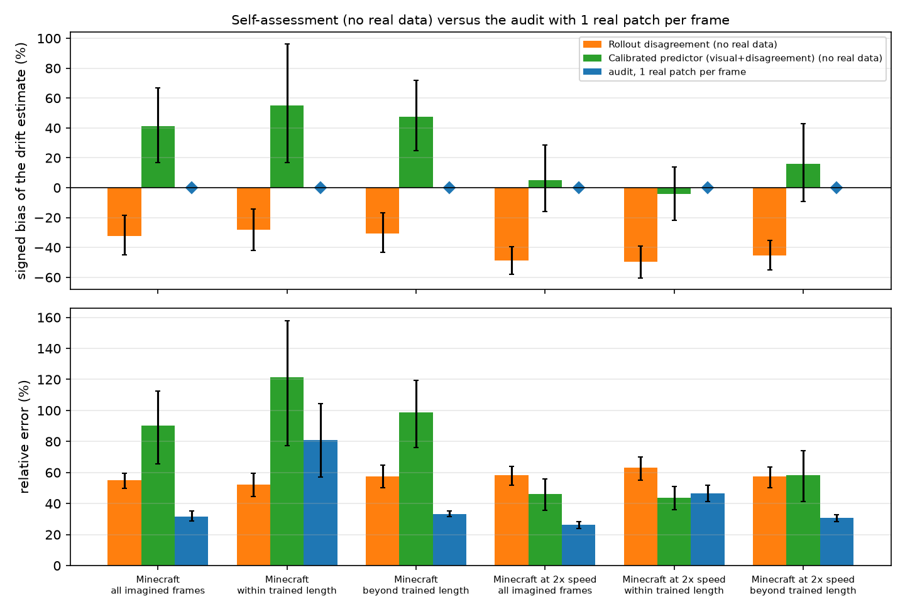
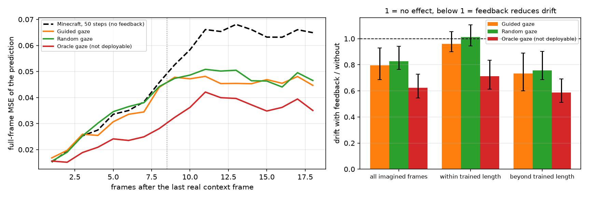
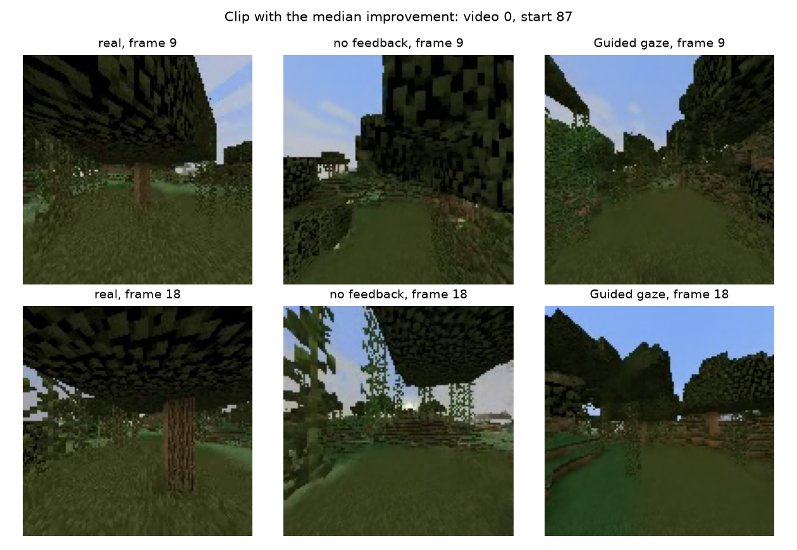
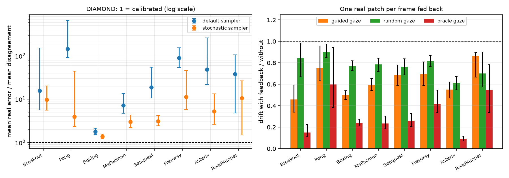
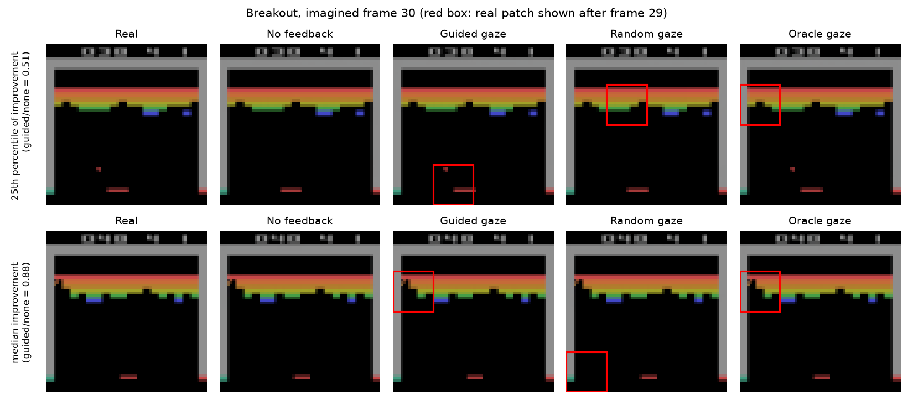

# wm-selfaudit

**Can a world model tell how far its imagination has drifted from reality?**

A video world model imagines the future, but it has no idea how wrong that imagined future is. The obvious fix is to ask the model itself: roll it out a few times and treat the disagreement between rollouts as its error estimate. I tried this on two pretrained diffusion world models and in both cases the answer is no, the model is over-confident.

- On [Diffusion Forcing](https://github.com/buoyancy99/diffusion-forcing) (NeurIPS 2024) in Minecraft, **the real error is 1.6 to 1.9 times the model's own disagreement**. I used the official Minecraft checkpoint (the repository's temporal-attention reimplementation). When the game is played at twice the training speed, the gap gets bigger (about 2.2 to 2.4 times). The same thing shows up with the perceptual distance LPIPS, not just pixel error.
- On [DIAMOND](https://github.com/eloialonso/diamond) (NeurIPS 2024), on 8 Atari games and 256 real episodes, it is much worse: real error is 1.8× to 144× the disagreement.

So I looked at how to measure the drift properly with very little real data. The agent looks at **one real 32×32 patch per frame (1/16 of the pixels)** and combines it with an error predictor that needs no real data at test time (it is fitted offline on other videos), using an importance-weighted control-variate estimator. The estimator itself is the patch-sampling audit from my earlier BioSaccade-PEM work, nothing exotic. The drift estimate it gives is **exactly unbiased**, whatever the predictor and whatever the shift, and on Minecraft it has roughly 0.6 to 0.7 times the variance of plain random patch checks.

Last, I feed that same patch back into the model. **Drift drops by 20%** on Minecraft (27% beyond the trained rollout length) and by **13 to 54%** on Atari, where a simple motion-guided gaze beats random gaze in 7 of 8 games. The patches still measure the drift while they are being fed back.

<p align="center">
  
</p>

## Results

### Minecraft (Diffusion Forcing)

I ran Minecraft twice:

- **Main run:** 40 clips (4 non-overlapping windows from each of the 10 quick-start validation videos), 3 rollouts per clip, 18 imagined frames per clip (twice the trained length), 50 DDIM steps. Only 10 independent videos here, so all intervals resample whole videos.
- **Held-out test run (notebook 06):** 72 clips from 72 *different* videos of the full TECO test split, one clip per video, same settings. Videos that also appear in the quick-start set were removed. This one has an effective sample size of 72, and I'd treat it as the main evidence.

**1. The model's own estimate of its drift is biased.** No real data at all is used here:

| Drift estimate (no real data) | 10 videos | 10 videos, 2× speed | 72 test videos | 72 test videos, 2× speed* |
|---|---|---|---|---|
| Rollout disagreement, bias | −32.5% (−44.8 to −18.5) | −48.7% (−57.9 to −39.6) | −13.7% (−24.5 to −2.8) | −52.3% (−63.5 to −41.2) |
| Regression predictor fitted on other videos, bias | +41.3% (+16.8 to +67.0) | +5.2% (−16.0 to +28.5) | +58.7% (+37.7 to +80.4) | −9.9% (−27.6 to +7.7) |
| **Audit, 1 real patch per frame, bias** | **0 (exact)** | **0 (exact)** | **0 (exact)** | **0 (exact)** |
| Mean real error / mean disagreement (1 = calibrated) | 1.85 (1.47–2.35) | 2.16 (1.68–2.80) | 1.60 (1.36–1.89) | 2.40 (1.85–3.26) |
| Same ratio with LPIPS | 1.48 (1.38–1.60) | 1.67 (1.52–1.91) | 1.34 (1.23–1.46) | 1.77 (1.48–2.19) |

\*The 2× speed condition of the test run only finished 16 of its planned 40 clips (7 of 15 jobs) before Kaggle's time limit, so its intervals are wide.

The over-confidence holds up on 72 new videos. It is a bit smaller than on the 10 quick-start videos (1.60 vs 1.85), and the regression predictor transfers badly between the two video sets, which is exactly why the audit should not depend on the predictor being right.

The rollouts are stochastic, so a plausible future doesn't have to match the recorded one, and drift is not a measure of realism. The calibration test still works though: for a calibrated model, reality and the rollouts are exchangeable, so the ratio is 1 for *any* distance. That is why I also report it with LPIPS (`results/perceptual/`, `results/test_split/perceptual/`).

**2. The audit is unbiased and cheaper than random checks.** Variance relative to plain uniform sampling (lower is better):

| Audit (1 real patch per frame) | 10 videos | 10 videos, 2× speed | 72 test videos |
|---|---|---|---|
| Uniform sampling (Horvitz–Thompson) | 1.00 | 1.00 | 1.00 |
| Uniform + visual control variate | 0.74 (0.69–0.82) | 0.64 (0.57–0.70) | 0.92 (0.80–1.04) |
| Uniform + visual + disagreement control variate | 0.68 (0.62–0.73) | **0.58 (0.50–0.65)** | 0.85 (0.71–1.01) |
| Uniform + *shrunk* visual + disagreement control variate | **0.63 (0.60–0.66)** | 0.62 (0.55–0.69) | not run** |
| Smart sampling + visual + disagreement control variate | 0.81 (0.66–1.01) | 0.63 (0.53–0.75) | **0.72 (0.63–0.83)** |
| Negative control (shuffled predictors) | 1.01 (1.00–1.01) | 1.00 (1.00–1.00) | 1.01 (1.01–1.01) |
| Oracle (not deployable) | 0.18 (0.16–0.22) | 0.18 (0.17–0.20) | 0.16 (0.14–0.17) |

\*\*The test run was analysed with the version of `wm_audit.py` inside notebook 06, which did not have the shrunk control variate yet. Its raw rollouts are still on Kaggle, so I haven't re-run the newer analysis on them.

Every estimator is unbiased. I check this exactly (largest bias below 1e-13) and by Monte Carlo. The *shrunk* control variate scales the predictor by a weight chosen on the other videos, so it stays unbiased and falls back to plain uniform sampling when the predictor doesn't transfer. Note that which audit is best changes between the two Minecraft runs: on 10 videos the uniform ones win, on 72 videos smart sampling wins. The gain itself is similar (about 0.6 to 0.7).

**3. Real patches beat extra rollouts.** I compare each budget through its best audit. On the 10 videos, three rollouts plus 1 real patch per frame is worth only 1.12 (1.06–1.18) real patches for a single rollout, and one rollout with 2 patches has 1.79 (1.70–1.89) times lower variance than three rollouts with 1. On the 72 test videos it is almost the same: 1.11 (1.00–1.23) and 1.81 (1.63–2.00).

**4. It's not the number of sampling steps.** On the same 16 clips, 50 and 100 DDIM steps give an error/disagreement ratio of 2.17 and 2.11. The difference is −0.06 (−0.38 to +0.26). I did not try other sampler settings.

**5. Feeding the patch back keeps the model closer to reality.** After each imagined frame, the real patch the agent looked at is pasted into the rollout. Drift is measured on the model's prediction of each frame, made *before* that frame's patch is shown. 16 clips, compared with the same clips without feedback:

| Patch chosen by | All frames | Within trained length | Beyond trained length | Clips improved |
|---|---|---|---|---|
| Guided gaze (no real data needed: where the imagined image changes most) | **0.80 (0.69–0.93)** | 0.96 (0.90–1.06) | **0.73 (0.60–0.89)** | 75% |
| Random gaze | 0.83 (0.76–0.94) | 1.01 (0.94–1.11) | 0.76 (0.69–0.90) | 62% |
| Oracle gaze (largest true error, not deployable) | 0.62 (0.55–0.73) | 0.71 (0.61–0.83) | 0.59 (0.51–0.69) | 100% |

Values are drift with feedback divided by drift without, so below 1 is better. The gain only starts once the two real context frames leave the model's 10-frame window; before that the context frames seem to keep the rollout anchored on their own. Guided gaze is not clearly better than random here, but the oracle shows that better targeting could almost double the gain. Feedback mostly rescues rollouts that have gone badly wrong, and in 4 of 16 clips it made the guided rollout worse. Using only 2 of the 3 baseline rollouts (to match the 2 feedback rollouts) doesn't change the ratios. With LPIPS the gain is smaller: 11% for guided gaze (CI 3–17%), 7% for random gaze (not significant) and 18% for the oracle.

The clip below is the one where open-loop drift was worst. Without feedback the model turns the field into a wall of leaves. With one real patch per frame (red box) it stays in the field. All 16 clips are in [`videos/`](videos).

<p align="center">
  
</p>

<p align="center">
  <br>
  <br>
  <br>
  
</p>

### Atari (DIAMOND)

These use the official pretrained DIAMOND world models and agents on 8 games. In each game the agent plays 32 real episodes. From one random window per episode, the world model is rolled out for 30 steps with the actions that were actually taken, and compared with what really happened. The whole thing ran on my laptop CPU in about 2.5 hours (`src/diamond_audit.py`).

| Game | Real error / disagreement | Same, stochastic sampler | LPIPS | Shrunk CV variance | Feedback: guided | Feedback: random | Feedback: oracle |
|---|---|---|---|---|---|---|---|
| Breakout | 15.7 (5.7–153) | 9.7 | 8.1 | 1.03 | **0.46 (0.34–0.59)** | 0.84 | 0.15 |
| Pong | 144 (91–651) | 3.9 | 154 | 1.01 | **0.75 (0.63–0.96)** | 0.90 | 0.60 |
| Boxing | 1.8 (1.5–2.1) | 1.4 | 1.6 | **0.43** | **0.50 (0.46–0.54)** | 0.77 | 0.24 |
| MsPacman | 7.2 (4.7–13.4) | 3.0 | 8.5 | 1.00 | **0.59 (0.54–0.65)** | 0.78 | 0.23 |
| Seaquest | 18.8 (10.6–54.5) | 3.1 | 24.2 | 0.99 | **0.69 (0.59–0.78)** | 0.76 | 0.26 |
| Freeway | 90 (54–155) | 11.2 | 110 | 0.99 | **0.69 (0.59–0.81)** | 0.81 | 0.42 |
| Asterix | 49 (22–262) | 5.2 | 64 | 1.29 | **0.55 (0.47–0.62)** | 0.61 | 0.09 |
| RoadRunner | 38 (5–105) | 10.6 | 24.1 | 1.00 | 0.87 (0.67–0.90) | **0.70** | 0.55 |

- **Over-confidence:** in every game, every interval is above 1, with the default sampler, with a stochastic sampler and with LPIPS.
- **Feedback:** reduces drift in all 8 games. Guided gaze beats random gaze in 7 of 8, which makes sense because in Atari the things that move are the things the model gets wrong.
- **Control variate:** helps a lot in Boxing (2.3× fewer patches needed) but not in most other games, where per-episode drift varies by orders of magnitude. The shrunk version stays near 1 there (Asterix 1.29, CI 1.00–1.99), so at least it doesn't make things much worse.
- **Unbiasedness:** every audit is exactly unbiased (largest bias 3e-13).

<p align="center">
  <br>
  
</p>

Side-by-side Atari videos (real | no feedback | guided | random | oracle) are in [`videos/diamond/`](videos/diamond).

## Method

For frame $t$ with $J$ patches and true patch errors $e_{tj}$, the agent first predicts an error $\mu_{tj}$ from what it already has. It then draws one patch $j$ with probability $q_{tj}$ and looks at the real patch:

$$\hat\Delta_t = \bar\mu_t + \frac{e_{tj} - \mu_{tj}}{J\,q_{tj}}, \qquad \mathbb{E}[\hat\Delta_t] = \frac{1}{J}\sum_j e_{tj}.$$

- **Predictors:**
  - *Visual*: texture and motion of the imagined patch, plus the time since the last real frame.
  - *Disagreement*: mean squared difference between independent rollouts. For a calibrated model, $\mathbb{E}\|g_r-x\|^2=\mathbb{E}\|g_r-g_s\|^2$.
  - Both are linear models fitted on the true patch errors of *other* videos (offline calibration). At test time they need no real data.
- **Smart sampling:** $q_j \propto \sqrt{\widehat{\mathbb{E}}[(e_j-\mu_j)^2]}$, with a 10% uniform floor.
- **Evaluation:** leave-one-video-out fitting, exact estimator variances (checked by Monte Carlo), a bootstrap over videos, a shuffled-predictor negative control, and a Neyman oracle as the upper bound.

## What's in here

```
src/wm_audit.py                      estimators, statistics, figures, self-tests
src/df_dump_run.py                   runs Diffusion Forcing validation unchanged on a fixed clip list and saves the raw predictions
src/df_feedback_run.py               same, but pastes one real patch per frame back into the rollout (closed loop)
src/perceptual_check.py              calibration and feedback re-measured with LPIPS (CPU)
src/make_videos.py                   side-by-side GIFs: real video | no feedback | closed-loop rollouts
src/diamond_audit.py                 DIAMOND (Atari) experiment: real episodes, open/closed-loop rollouts, CPU only
src/diamond_summary.py               per-game summary table and figure 10 for DIAMOND
src/prep_minecraft_test.py           pulls the held-out Minecraft test split (last ~2.1 GB of the 225 GB archive) with range requests

notebooks/01_pilot.ipynb                 first pilot (8 clips, 8 imagined frames), executed
notebooks/02_main_experiments.ipynb      main run: 40 + 24 clips, 3 rollouts, 50 steps, executed (7.9 h on 2x T4)
notebooks/03_sampling_steps_check.ipynb  the same 16 clips at 100 steps, executed (3.9 h on 2x T4)
notebooks/04_closed_loop_feedback.ipynb  the same 16 clips with one real patch per frame fed back, 3 gaze policies, executed (3.6 h on 2x T4)
notebooks/05_prepare_minecraft_test.ipynb  CPU only, extracts the Minecraft test split for notebook 06 (code only, its output is the dataset)
notebooks/06_scaled_test_split.ipynb     the main experiment on 72 held-out test videos (+ 2x speed), executed (10.2 h on 2x T4)

results/main/             main run: results.md, summary.json, per-unit results, figures 1-6, clip plan, generation logs
results/test_split/       72-video test run (notebook 06): results.md, figures 1-6, LPIPS calibration
results/sampling_steps/   50 vs 100 steps (steps_check.md, figure 7) and the full analysis of both
results/closed_loop/      feedback results (feedback.md, feedback.json, figures 8-9, generation logs)
results/perceptual/       LPIPS calibration and feedback
results/diamond/          DIAMOND: audit analysis, per-game feedback, LPIPS, summary (diamond_summary.md), figures 10-11
results/pilot/            pilot results
videos/                   side-by-side GIFs of the 16 closed-loop Minecraft clips and of the Atari games
```

## Reproducing

The notebooks run on Kaggle (**GPU T4 x2**, Internet on). Each one clones the official Diffusion Forcing repo, downloads the official checkpoint and data, generates the rollouts and runs the analysis.

1. Run `notebooks/02_main_experiments.ipynb` (about 8 h).
2. Attach its output as an input to `notebooks/03_sampling_steps_check.ipynb` and run it (about 4 h). It reuses the 50-step rollouts.
3. Attach the same output to `notebooks/04_closed_loop_feedback.ipynb` and run it (about 4 h). It reuses the rollouts without feedback.
4. For the held-out test run, run `notebooks/05_prepare_minecraft_test.ipynb` (CPU), then attach its output to `notebooks/06_scaled_test_split.ipynb`. The normal-speed part takes about 9 h; the 2× speed part needs a second session (attach the notebook's own output and run it again).

Generation stops on its own before Kaggle's 12-hour limit. If a run gets cut short, attach the previous version's output and run it again; finished rollouts are reused.

Re-running the analysis doesn't need a GPU (Python with numpy, scipy and matplotlib):

```
python src/wm_audit.py selftest
python src/wm_audit.py analyze --data <wm_audit_data from notebook 02> --out results/main
python src/wm_audit.py compare --data <wm_audit_data from notebook 03> --out results/sampling_steps --a minecraft --b minecraft_steps100
python src/wm_audit.py feedback --data <wm_audit_data from notebook 04> --out results/closed_loop --a minecraft --conds feedback_guided feedback_random feedback_oracle
python src/perceptual_check.py --data <wm_audit_data from notebook 02> --out results/perceptual --conds minecraft minecraft_fast
python src/perceptual_check.py --data <wm_audit_data from notebook 04> --out results/perceptual --feedback
```

The LPIPS check needs `pip install torch torchvision lpips` and takes about 5 minutes on a CPU.

The DIAMOND experiment runs on a CPU. You need the [DIAMOND repo](https://github.com/eloialonso/diamond) and its requirements (Python ≤ 3.12; the Atari ROMs come with `ale-py`, and installing it means accepting their licence):

```
python src/diamond_audit.py --diamond <path to diamond> --out diamond_data
python src/wm_audit.py analyze --data diamond_data --out results/diamond
python src/wm_audit.py feedback --data diamond_data --out results/diamond/feedback/breakout --a breakout --conds breakout_fb_guided breakout_fb_random breakout_fb_oracle
python src/diamond_summary.py --results results/diamond
```

`results/` is regenerated by these commands, so it can differ slightly from what is printed inside the notebooks. After those runs I changed the rollouts-versus-patches comparison to use the best audit for each rollout budget, and added one more audit (uniform sampling with the 2-rollout control variate). `results/test_split/` is the exception: it is taken directly from the outputs of notebook 06.

The raw rollouts (400 to 600 MB per run) are not in this repo. They are the `wm_audit_data` folder in each notebook's output.

## Limitations

- **Two models, both trained on games.** The Atari frames are small (64×64). I haven't tested larger, photorealistic world models.
- **Minecraft sample size.** The main run has only 10 independent videos. The 72-video test run fixes this for calibration and the audit, but its 2× speed part is unfinished (16 of 40 clips), and the sampling-steps and feedback experiments are still on the 16 clips from the quick-start videos.
- **Drift is measured against the one recorded future.** The calibration test is valid under the model's randomness, but drift says nothing about how realistic a rollout looks.
- **The variance gain depends on the predictor.** About 1.4 to 1.6× equivalent observations on Minecraft and 2.3× on Boxing, nothing in most Atari games. The 2.9× I saw in the 8-clip pilot did not hold up at scale, and which sampling scheme is best is not stable between the two Minecraft runs.
- **The Minecraft closed-loop experiment is small.** 16 clips and 2 rollouts per gaze policy, and the patch is fed back by just pasting it into the generated frame. On Minecraft, guided gaze is not clearly better than random (it is on Atari). The online drift estimate from the same patches is unbiased in expectation. Pooled over rollouts it is within error of zero for random gaze (+1%) and in 15 of 16 Atari cases. With guided gaze on Minecraft it came out 17% low (CI −23% to −5%), which I think comes from heavy-tailed importance weights (up to 10×) that 32 rollouts don't sample well.

## Credits

The Diffusion Forcing code, checkpoints and data belong to their authors and are not redistributed here:

> B. Chen, D. Martí Monsó, Y. Du, M. Simchowitz, R. Tedrake, V. Sitzmann. *Diffusion Forcing: Next-token Prediction Meets Full-Sequence Diffusion.* NeurIPS 2024.

The Minecraft data come from the TECO dataset (W. Yan, D. Hafner, S. James, P. Abbeel, ICML 2023). DIAMOND is by E. Alonso, A. Jelley, V. Micheli, A. Kanervisto, A. Storkey, T. Pearce and F. Fleuret (NeurIPS 2024).

## Citation

```bibtex
@misc{usman2026wmselfaudit,
  author = {Muhammad Usman},
  title  = {Measuring and Correcting Rollout Drift in Diffusion World Models with Sparse Real Observations},
  year   = {2026},
  url    = {https://github.com/MrUsmanAjmal/wm-selfaudit}
}
```

## Author

Muhammad Usman, [github.com/MrUsmanAjmal](https://github.com/MrUsmanAjmal)
